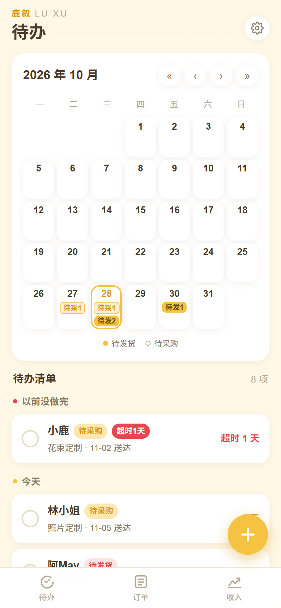
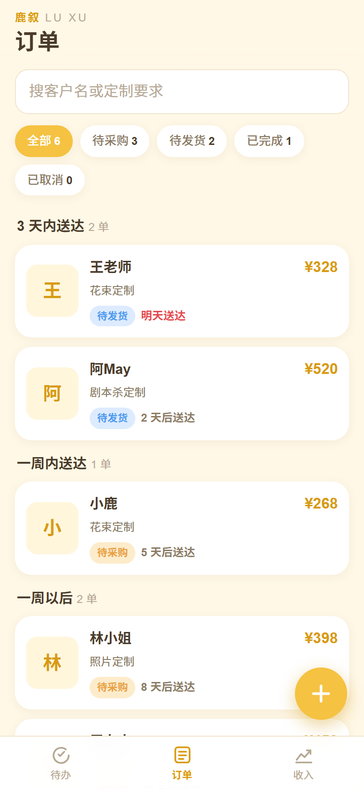
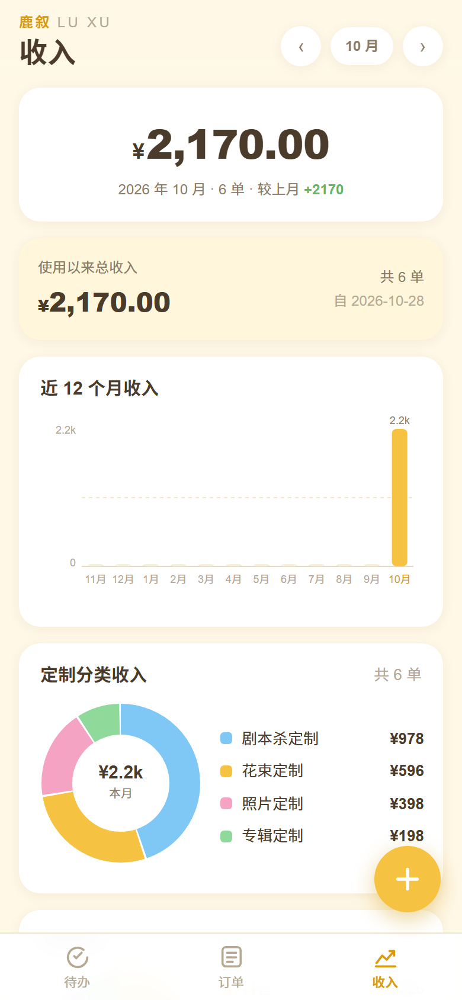
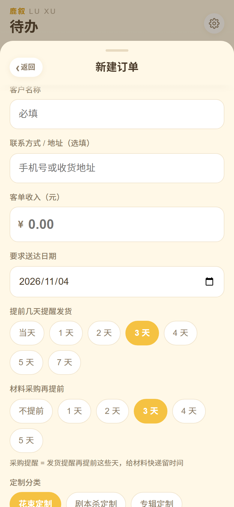

# 鹿叙 LU XU · 接单记账

> 一个给花艺 / 永生花定制小工作室用的手机端接单管理 PWA。纯前端、零依赖、不用构建，数据存在自己的手机里，能离线用。

## 为什么做这个

定制单的「送达日期」是定死的，但「哪天该买材料」「哪天该发货」得自己往前倒推，单子一多就容易漏。

这个 App 把两个提前量写进每一单里，自动算出采购日和发货日，铺在月历上——**打开日历就知道今天要做什么，不用再翻订单列表算日子。**

## 功能

**待办页（首页）**
- 月历按「采购日 / 发货日」落点，格子上标 `待采N` / `待发N`
- 点某一天，看当天要采购哪些单、要发哪些单（下方保留已处理项供回看）
- 待办清单按「以前没做完 / 今天 / 明天 / 后天 / 后 7 天内」分组，同组内待采购排在待发货前面
- 逾期项标红

**订单页**
- 新建 / 编辑 / 状态流转（待采购 → 待发货 → 已完成 / 已取消）
- 每单可存最多 9 张配图，自动压到 1600px + 生成缩略图
- 按状态筛选、按客户名/要求搜索

**收入页**
- 本月收入、使用以来总收入
- 近 12 个月收入柱状图
- 定制分类收入、客源收入两个甜甜圈

**其他**
- 导出 / 导入 JSON 备份，可设备份提醒周期
- PWA：加到主屏幕后全屏运行、离线可用

## 截图

| 待办 | 订单 | 收入 | 新建订单 |
|:---:|:---:|:---:|:---:|
|  |  |  |  |

## 快速开始

没有任何依赖，不需要 npm install，也不需要构建：

```bash
git clone <你的仓库地址>
cd luxu
python3 -m http.server 8080
```

然后打开 <http://localhost:8080>。

也可以换成任意静态服务器，比如 `npx serve`。

> ⚠️ 请用 http 服务打开，**不要直接双击 `index.html`**。`file://` 协议下 Service Worker 无法注册、IndexedDB 也会受限，PWA 安装和配图功能都不正常。

## 装到手机上

- **iOS Safari**：打开页面 → 底部「分享」→ 添加到主屏幕
- **Android Chrome**：右上菜单 → 安装应用 / 添加到主屏幕

加到主屏幕后是全屏无地址栏的独立图标，并且**不受 Safari「7 天未访问清理网站数据」影响**——这也是建议从主屏幕图标进、而不是从浏览器标签进的原因。

## 数据存在哪（重要，请先读）

这个 App **没有后端、没有账号、不向任何服务器上传数据**。所有内容都在你自己的浏览器里：

| 内容 | 存储位置 | 键名 / 库名 |
|---|---|---|
| 订单、设置、待办勾选、元信息 | localStorage | `luxu.orders.v1`、`luxu.settings.v1`、`luxu.todoDone.v1`、`luxu.meta.v1` |
| 订单配图（原图 + 缩略图） | IndexedDB | 库 `luxu-db`，表 `photos` |
| 上一版订单快照 | localStorage | `luxu.orders.bak.v1`（每次保存前自动留一份） |

由此带来几个后果：

- **换设备、换浏览器 = 数据不跟过去**，新设备打开是空的
- **清除浏览器数据、删除主屏幕图标、无痕模式关闭 = 数据丢失**
- **备份文件不含配图**：导出的 JSON 只有订单文字，图片留在原设备的 IndexedDB 里
- 容量：文字几乎不占空间（上万单也只是几 MB）；图片是大头，一单一张图约 0.4 MB，iOS 对单个站点通常约 1 GB 额度

所以：**请定期到设置页导出备份**，换手机前先导出再导入。

## 日期规则（核心逻辑）

每单有 `送达日 dueDate` 和两个提前量：

| 字段 | 含义 |
|---|---|
| `shipLead` | 发货提前天数：送达日前 N 天发货 |
| `buyLead` | 采购提前天数：送达日前 N 天买材料 |

表单里第二个是用相对量填的：「材料采购再提前 M 天」，保存时换算成 `buyLead = shipLead + M`。例如送达 11-10、发货提前 4、采购再提前 4 → 采购提醒落在 11-02（提前 8 天）。

推导出的两个日期：

```
发货提醒日 = 送达日 − shipLead
采购提醒日 = 送达日 − buyLead
```

状态与日期的关系：

| 状态 | 是否进待办 | 日历落点 |
|---|---|---|
| `tobuy` 待采购 | 是 | 采购日标「待采」 |
| `ready` 待发货 | 是 | 发货日标「待发」 |
| `done` 已完成 / `canceled` 已取消 | 否 | 只在当日弹层的「已处理」里回看 |

## 目录结构

```
luxu/
├─ index.html           单页外壳：顶栏、底部导航、弹层/图片查看器/Toast 容器
├─ app.css              全部样式，配色集中在顶部 :root 变量
├─ store.js             数据层：localStorage + IndexedDB 读写、日期推导、统计、导入导出
├─ views.js             视图层：各页面与四个弹层（设置/表单/详情/日历某天）的 HTML 生成
├─ app.js               控制层：事件委托、URL 路由（?tab= / ?order= / ?open=form / ?day=）、弹层手势
├─ charts.js            纯手写 SVG 图表（柱状图 + 甜甜圈），无图表库
├─ sw.js                Service Worker，静态资源缓存
├─ manifest.webmanifest PWA 清单
├─ icons/               应用图标（含 maskable）
└─ docs/screenshots/    README 用截图
```

**架构**：没有框架、没有依赖、没有构建步骤。三个命名空间 `LX.store` / `LX.views` / `LX.charts`，`app.js` 用**一个事件委托**监听 `document`，靠元素上的 `data-act` 分发（`save` / `edit` / `close-sheet` / `setd` …），局部状态放在 `UI` 对象里。渲染是全量重绘 `#view` 的 innerHTML。

## 自定义

| 想改什么 | 改哪里 |
|---|---|
| 定制分类、客源渠道 | 设置页可直接增删（删客源不影响已有订单） |
| 默认提前天数 | 设置页「默认提前天数」加减器（0–30） |
| 每单可选的提前天数档位 | `views.js` 表单里两个数组：`#f-lead`（发货）和 `#f-buypre`（采购再提前） |
| 配色 | `app.css` 顶部 `:root` 的 CSS 变量 |
| 品牌名 / 图标 | `index.html` 的 `.tb-brand`、`manifest.webmanifest`、`icons/` |

## 改完代码要注意

改了 `index.html` / `*.js` / `*.css` 之后，要把 Service Worker 的缓存版本号改掉，否则手机上还会读旧缓存：

- `sw.js` 里的 `luxu-v16` → `luxu-v17`
- `store.js` 里的 `var BUILD = 'v16'` → `'v17'`（设置页底部会显示这个版本号，方便确认有没有生效）

## 已知限制

- **单设备**：没有账号和云同步，多设备之间不互通
- **备份不含配图**（见上文「数据存在哪」）
- 只在 iOS Safari 和桌面 Chrome 上测过，没做旧浏览器兼容
- 代码是 ES5 风格的原生 JS，刻意不引构建工具，好处是改完刷新生效、坏处是没有类型检查

## 贡献

欢迎提 Issue 和 PR。改动前建议先开个 Issue 说一下想做什么，避免方向不一致白做。

提 PR 请顺手：改完自测一遍主要流程（新建 → 改状态 → 看日历落点 → 看收入），并升一下 SW 缓存版本号。

## 许可证

[MIT](LICENSE) © 2026 鹿叙 (LU XU)
